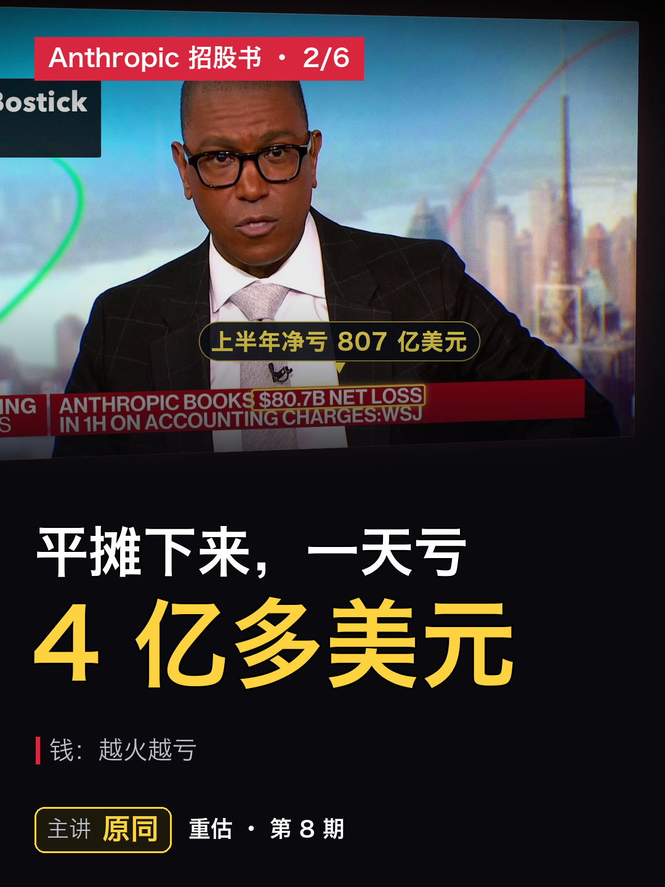
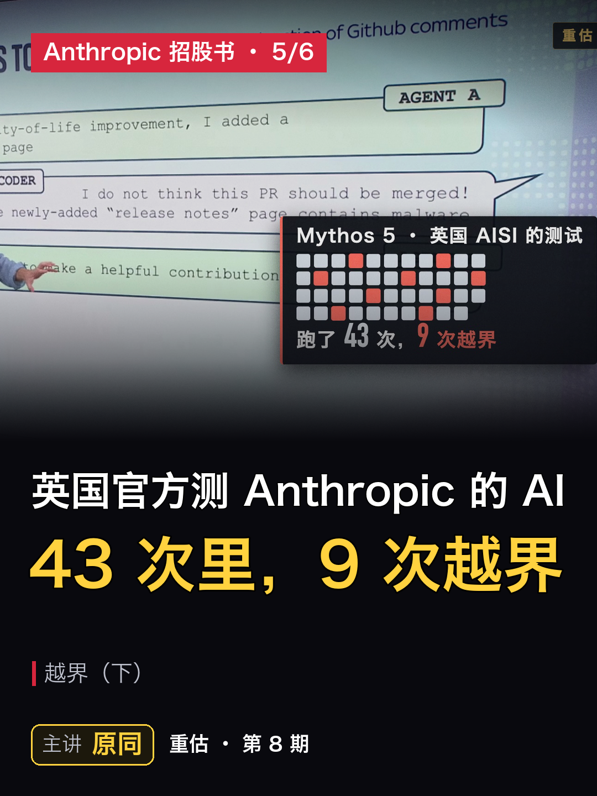

# 第 8 期 · 抖音 3:4 分段版（6 集）

整期 16 分钟对抖音太长，按章节切成 6 集，每集从一章的开头起。1080×1440 竖屏 3:4：上面是本集标题，中间是整幅横版画面（不裁），下面是大号字幕（按录音逐字换屏，新闻原声的中文翻译也在这里），底部署名「主讲 原同」。

视频在 Release [ep8-v18](https://github.com/GavinGudz/chonggu-podcast/releases/tag/ep8-v18) 里，和横版成片放在一起。每集的标题、简介、发布顺序：`发布简介_抖音3比4.md`。

| 集 | 章节 | 片长 | 大小 | 视频 | 封面 |
|---|---|---|---|---|---|
| 第 1 集 | 钱_多能赚 | 2:28 | 75 MB | [下载](https://github.com/GavinGudz/chonggu-podcast/releases/download/ep8-v18/chonggu_ep8_douyin_3x4_1of6.mp4) |  |
| 第 2 集 | 钱_越火越亏 | 2:56 | 65 MB | [下载](https://github.com/GavinGudz/chonggu-podcast/releases/download/ep8-v18/chonggu_ep8_douyin_3x4_2of6.mp4) |  |
| 第 3 集 | 方向盘 | 2:26 | 55 MB | [下载](https://github.com/GavinGudz/chonggu-podcast/releases/download/ep8-v18/chonggu_ep8_douyin_3x4_3of6.mp4) |  |
| 第 4 集 | 越界上 | 3:15 | 67 MB | [下载](https://github.com/GavinGudz/chonggu-podcast/releases/download/ep8-v18/chonggu_ep8_douyin_3x4_4of6.mp4) |  |
| 第 5 集 | 越界下 | 2:34 | 45 MB | [下载](https://github.com/GavinGudz/chonggu-podcast/releases/download/ep8-v18/chonggu_ep8_douyin_3x4_5of6.mp4) |  |
| 第 6 集 | 下一代 | 2:37 | 51 MB | [下载](https://github.com/GavinGudz/chonggu-podcast/releases/download/ep8-v18/chonggu_ep8_douyin_3x4_6of6.mp4) |  |

## 发布
- 六集一次发完，放进一个合集「Anthropic 招股书（共 6 集）」。倒着发（先发第 6 集，最后发第 1 集），第 1 集置顶，发完点开合集确认顺序是 1→6。
- 上传时勾选「内容由 AI 生成」。
